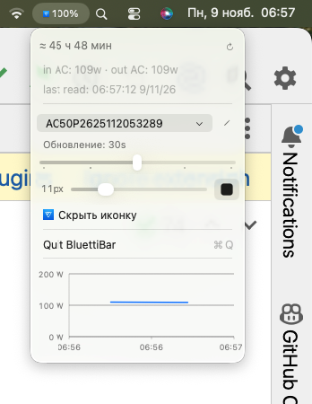

# BluettiBar 2.0.5

BluettiBar shows a BLUETTI AC50P’s battery level and output power next to the Mac clock. It uses Swift and the frameworks included with macOS.



## Installation

On macOS 12 or later, install Apple Command Line Tools with `xcode-select --install` if needed. From the project directory, run

```bash
./install.command
```

The installer builds and tests the app, starts it, enables launch at login, and reveals it in Finder. It uses `/Applications` when writable and `~/Applications` otherwise. Updates preserve preferences, station aliases, and the last reading.

Allow Bluetooth access when prompted. If the station is busy, disconnect the BLUETTI phone app.

## Menu bar

A reading such as **73% 135 W** shows the battery level followed by the combined AC and DC output. Use the menu to show or hide the icon, percentage, and output power. Hiding output power restores the percentage. The percentage also appears when a reading lacks a complete output measurement.

Before the first reading, the BLUETTI icon opens the menu. If the station goes offline, the app keeps its last reading and shows when it was taken. Automatic polling pauses after a failed read and three retries. Click Refresh, select a station, or wake the Mac to resume polling.

Open the menu to see the runtime estimate, input and output power, and the past 30 minutes of load history. The station picker and pencil let you select and rename a station. You can also change the text color, size, and refresh interval.

If macOS hides the status item, open BluettiBar again in Finder to show its menu. Choose **Quit BluettiBar** to exit. Run `./uninstall.command` to uninstall.
